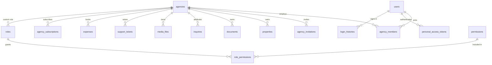

# DATABASE_ERD.md — TaisarTownHub

**Source of truth:** the applied migrations in `backend/database/migrations` (30 additive
migrations) and the live schema of the dev database (SQLite in this workspace, MariaDB-compatible
DDL). Table/row counts below were read from the live database with
`php artisan platform:inventory` (2026-11-13).

---

## 1. Tenancy model

**Rule:** the tenancy boundary is `agency_members` (an *active* membership row). `agency_id` on a
resource is a stamp written by the server, never accepted from the client.

---

## 2. Identity & access

| Table | Key columns | Notes |
|---|---|---|
| `users` | `id`, `email`, `password` (hashed), `role`, `status`, `agency_id`, `failed_attempts`, `locked_until`, `last_login_at`, **`mfa_secret`** (encrypted), **`mfa_enabled_at`**, **`mfa_recovery_codes`** (encrypted JSON, hashed codes) | MFA material is encrypted at rest through the model casts (`encrypted`, `encrypted:array`) |
| `personal_access_tokens` | Sanctum tokens | 24 h expiry (`config/sanctum.php`), `tth_` prefix |
| `login_histories` | `user_id`, `email`, `ip_address`, `user_agent`, `success`, `mfa_used`, `suspicious`, `reason` | Append-only trail of every sign-in attempt (Phase 6) |
| `email_verification_tokens` | `email`, `token_hash` (SHA-256), `created_at` | 60-minute window, tracked but not login-blocking |
| `password_reset_tokens` | Laravel broker tokens | Reset revokes **all** sessions |
| `permissions` | `key`, `label`, `group`, `is_platform` | 62 rows |
| `roles` | `scope` (platform/agency), `agency_id`, `key`, `permissions` (JSON), `is_system` | 13 system roles |
| `role_permissions` | `role_id`, `permission_id` | 362 grants |
| `agency_members` | `agency_id`, `user_id`, `role_id`, `status` | **The tenancy source of truth** |
| `agency_invitations` | `agency_id`, `email`, `token_hash`, `role_id`, `expires_at` | Invite tokens hashed at rest |

---

## 3. Catalogue & workflow

| Table | Purpose |
|---|---|
| `properties` | Listing master: price, sector/block, phase, type, status, `approval_status`, `visibility`, `agency_id`, `assigned_dealer_id`, `pending_changes` (JSON staging) |
| `property_status_history` | Every approval/rejection/feature transition |
| `property_favorites` / `property_views` | Per-account engagement |
| `property_categories` / `sectors` / `blocks` | Location taxonomy used by the public site and the admin editor |
| `projects` / `agency_videos` / `video_comments` / `video_likes` | Marketing inventory + engagement |
| `dealers` / `dealer_files` | Dealer registry (CNIC **encrypted** via `Dealer::$casts`) and file handovers |

## 4. CRM, finance & documents

| Table | Purpose |
|---|---|
| `inquiries` | Public leads with `lead_status`, `follow_up_at`, `agency_id`, `assigned_agent_id` |
| `lead_activities` | Lead activity history |
| `transactions` | Deal master: `deal_status` (10-stage machine), `voided_at`, `deal_number` |
| `transaction_payments` | Payment ledger (bigint PKR — no floating point) |
| `payment_schedules` | Milestone/installment plans |
| `commissions` | Agent commissions with accrual + reversal |
| `expenses` | Agency overhead ledger (soft-deletable, audited) |
| `subscription_plans` / `agency_subscriptions` / `subscription_invoices` | Plans, quotas, immutable paid invoices |
| `document_folders` / `documents` / `document_versions` / `document_access_logs` | Private vault on a **non-servable** disk; every read is access-logged |
| `document_shares` | Public capability links: SHA-256 token hash only, expiry, revocation, download cap |
| `media_files` | Media studio assets (public/private visibility, sale attribution) |

## 5. Operations

| Table | Purpose |
|---|---|
| `audit_logs` | Append-only audit (actor, role, action, target, agency, metadata, cross_agency flag) |
| `support_tickets` / `support_messages` | Module 15 support desk (immutable message threads) |
| `notifications` | In-app notifications (Laravel database channel, UUID PK) |
| `system_settings` | Platform configuration (12 seeded keys: security limits, brand, plans) |
| `agency_subscriptions` / `subscription_invoices` | Entitlement + billing artefacts |
| `business_records` | Legacy ERP JSON store (96 rows) — hardened with `agency_id`, merged read-only; being migrated module-by-module to the typed tables above |
| `jobs` / `failed_jobs` / `job_batches` | Database queue (queued mail, notifications) |
| `cache` / `sessions` | Database cache & session drivers |

---

## 4. Money, IDs and encryption rules

| Concern | Rule |
|---|---|
| Money | `bigInteger` PKR (rupees) — never floating point. Formatting happens in the UI only. |
| Identifiers | String surrogate keys (`agy_…`, `doc_…`, `tkt_…`) for tenant resources; integer IDs for RBAC/audit |
| Sensitive data | `Dealer::$casts['cnic'] = 'encrypted'`, `User` MFA columns encrypted — Laravel `APP_KEY` protects them; **the value is masked in every API response** (`view_sensitive_cnic` required to unmask) |
| Private files | `storage/app/private/documents` on a disk with `serve = false`; bytes are streamed only through authenticated, policy-checked, audit-logged endpoints |
| Indexes | Composite `(agency_id, status, created_at)`-style indexes on the hot list endpoints, plus a unique index on `document_shares.token_hash` |
| Migrations | 100 % additive — no dropped or renamed columns; `2026_11_13_000001…000004` added CNIC encryption, verification tokens, module 15 tables and MFA/login history |
