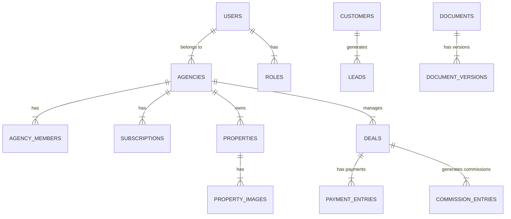

# TaisarTownHub — Database ERD (Condensed)

## Entity Relationship Overview

## Core Tables (Existing Project)

Based on existing code and reports, these tables are already designed:

- `users` - Auth users with role/agency assignment
- `properties` - Property listings with public/private fields
- `dealers` - Dealer agency records
- `sellers`, `buyers` - Customer records
- `transactions` / `deals` - Transaction lifecycle
- `payments` - Payment ledger entries
- `commissions` - Commission tracking
- `inquiries` - Customer inquiries
- `documents` - Attached files
- `agencies` - Agency records
- `subscriptions` - SaaS plans

## Tenant Isolation

- **All entities have `agency_id`** for scoping
- **Public data** has `agency_id = null`
- **Backend middleware** enforces agency filtering
- **Frontend `authorize()`** function handles RBAC scoping