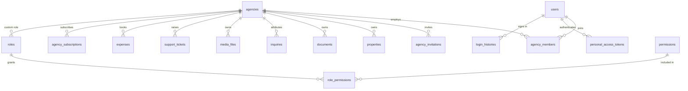

# TaisarTownHub — Database

**Source of truth:** applied migrations in `backend/database/migrations` (additive, MySQL 8-first) and `php artisan platform:inventory` (live schema probe). This consolidates the former root `DATABASE_SCHEMA.md`, `DATABASE_ERD.md` and `DATABASE_ERD_DATA_DICTIONARY.md`.

## Engine policy

- **MySQL 8 is the primary database** for development and production (`backend/.env.example` defaults to `DB_CONNECTION=mysql`).
- SQLite (`:memory:`) is used only for the fast default test run (`phpunit.xml`). The MySQL 8 suite runs in CI and must stay green.
- Credentials always come from environment variables — nothing is hardcoded.

## Tenancy model

**Rule:** the tenancy boundary is `agency_members` (an *active* membership row). `agency_id` on a resource is a server-written stamp, never accepted from the client. Cross-tenant reads return 404.

## Table groups (summary)

| Group | Tables | Notes |
|---|---|---|
| Identity & access | `users`, `personal_access_tokens`, `login_histories`, `agencies`, `agency_members`, `agency_invitations`, `roles`, `permissions`, `role_permissions` | 62 permissions, 13 system roles (7 agency-scoped + 6 platform); grants enforced via `AuthorizesApi` |
| Listings | `properties`, `property_images` (media), `map_*` tables | full-text + composite indexes; sale-only marketplace |
| CRM & leads | `inquiries`, `agency_leads`-family (activities), `business_records` | inquiry → agency attribution server-side; legacy `business_records` are platform-owned unless backfilled |
| Vault | `documents`, `document_versions`, `document_shares` | private disk + quarantine disk; hashed share tokens, expiry, download caps |
| Finance | `transactions`/`deals`, `payment entries`, `commission entries`, `expenses` | append-only ledger; paid invoices immutable; voids audited |
| Subscriptions | `plans`, `agency_subscriptions`, `subscription_invoices`, `invoice_sequences` | plan quotas enforced at write time; yearly invoice numbers reserved under a transactional row lock |
| Media | `media_files` | visibility-controlled; public file route serves only while visible |
| Ops | `support_tickets`(+messages), `notifications`, `audit_logs`, `cms/settings` | audit trail flags cross-agency actions |

Detailed per-column dictionaries live in the migrations themselves — that is the authoritative schema. Run `php artisan platform:inventory` for a live table/index/row-count dump.

## Enum conventions (as enforced by validation)

- Transaction status: Draft, Negotiation, Agreement Signed, Payment Pending, Partially Paid, Fully Paid, Completed, Cancelled, Under Transfer.
- Commission status: Pending, Paid, Unpaid, Partially Paid.
- Soft delete for sellers/buyers/dealers: archived flag when referenced by history (no hard delete that would orphan ledgers).
