# TaisarTownHub — Enterprise Architecture Blueprint (Phase 2 Design)

> This document defines the target database architecture, multi-tenant isolation
> model and RBAC permission structure for the enterprise upgrade. It is derived
> from the Phase 1 code audit (see `UPGRADE_MASTER.md`) and is the specification
> implemented by the migrations in `backend/database/migrations/`.

---

## 1. Current-State Summary (Phase 1 Audit — Backend)

| Area | Current state | Problem |
|---|---|---|
| Tenancy | **No `agencies` table.** Agency = free-text (`dealers.agencyAffiliation`, `properties.agencyName`) | No data isolation possible; blueprint requires agency-level ownership on every record |
| RBAC | Static PHP constant `RolePermissions::MATRIX` keyed by `users.role` (5 legacy roles) | No custom agency roles; no platform/agency role split; `allows()` vs `forRole()` disagree for unknown roles |
| Auth | Sanctum bearer tokens, 5 demo users | Tokens never expire; open registration mints fake featured properties; no per-account login lockout |
| Data store | Dual-write: Eloquent tables **and** generic `business_records` JSON blob (15 collections) | Two sources of truth that drift; `PUT /api/workspace` accepts unvalidated rows and soft-deletes rows missing from payload |
| Documents | `dealer_files` (URLs, `buyer_cnic` plaintext, dealer-scoped only) | No folders, no versions, no access logs, no private-disk storage, no agency isolation |
| Property workflow | `properties.status` free-text (`Available`/`Hot Deal`) | No Draft→Pending→Approved→Rejected→Expired lifecycle, no moderation queue, no re-approval on edit |
| CRM | `inquiries` table (no `agency_id`, no `property_id` FK, no lead pipeline) | Not agency-scoped; `view_inquiries` (a *view* permission) authorizes status writes |
| Finance | `transactions` (string refs, no FKs, create-only API) | No payments table, no update/void/approve endpoints, deal-number race |
| Notifications | None | — |
| Subscriptions/quotas | None | — |
| Favorites/views | None (localStorage only) | — |
| Sectors/blocks | Free-text columns on properties | No location pages data structure |

### Top security weaknesses carried into Phase 2/3 (from audit)

1. `GET /api/workspace` — full ERP dump gated only by `view_properties` (dealers/operators qualify), zero record-level filtering. (`WorkspaceController.php:61-72`)
2. `PUT /api/workspace` — unvalidated mass overwrite + mass soft-delete of rows absent from payload. (`WorkspaceController.php:74-109,145-162`)
3. Unauthenticated `POST /videos/{id}/like|comments` with client-supplied `userName`/`isDealer` (impersonation). (`routes/api.php:104-105`)
4. `APP_DEBUG=true` + catch-all renderer leaking exception internals. (`.env:4`, `bootstrap/app.php:44-56`)
5. Open registration fabricates 3 featured "verified" properties + fake stats per registrant. (`AuthController.php:54-248`)
6. Client-supplied primary keys & foreign keys trusted (`properties.id`, `dealers.id`, `transactions.dealerId`, `videos.agencyId`). 
7. View permissions used as write gates (`view_inquiries` → status write; `view_properties` → workspace write entry gate).
8. Sanctum tokens never expire; logout revokes only current token; login throttle is per-IP only.
9. No FK constraints on `properties.assignedDealerId`, `transactions.dealerId/propertyId`, `users.dealer_id`, `video_comments.agency_video_id`.
10. Financial writes via workspace sync bypass `TransactionController` validation; audit is best-effort and silent-fail.

---

## 2. Target ERD (Mermaid)

```mermaid
erDiagram
    users ||--o{ agency_members : "belongs"
    agencies ||--o{ agency_members : "has"
    agencies ||--o{ agency_settings : "has"
    agencies ||--o{ agency_subscriptions : "has"
    subscription_plans ||--o{ agency_subscriptions : "plan"
    agencies ||--o{ roles : "custom roles"
    roles ||--o{ agency_members : "assigned"
    roles ||--o{ role_permissions : "grants"
    permissions ||--o{ role_permissions : "granted"

    agencies ||--o{ properties : "owns"
    agencies ||--o{ dealers : "owns"
    agencies ||--o{ document_folders : "owns"
    agencies ||--o{ documents : "owns"
    agencies ||--o{ media_files : "owns"
    agencies ||--o{ inquiries : "receives"
    agencies ||--o{ transactions : "owns"
    agencies ||--o{ notifications : "receives"
    agencies ||--o{ audit_logs : "scoped"

    property_categories ||--o{ properties : "categorizes"
    sectors ||--o{ blocks : "contains"
    blocks ||--o{ properties : "locates"
    sectors ||--o{ properties : "locates"

    properties ||--o{ property_media : "public media"
    properties ||--o{ property_documents : "private docs"
    properties ||--o{ property_status_history : "workflow"
    properties ||--o{ property_favorites : "saved by"
    properties ||--o{ property_views : "viewed by"
    properties ||--o{ inquiries : "referenced by"
    properties ||--o{ transactions : "sold via"

    documents ||--o{ document_versions : "versions"
    documents ||--o{ document_access_logs : "accessed"
    media_files ||--o{ media_usage : "reused in"

    inquiries ||--o{ lead_activities : "notes/followups"
    transactions ||--o{ transaction_payments : "payments"
    transactions ||--o{ commissions : "commission"

    users ||--o{ audit_logs : "acts"
    users ||--o{ notifications : "receives"
```



### Relationship summary

| Parent | Child | FK column | On delete |
|---|---|---|---|
| agencies | agency_members | agency_id | cascade |
| agencies | properties | agency_id | restrict (financial/ownership integrity) |
| agencies | documents | agency_id | restrict |
| agencies | document_folders | agency_id | cascade |
| agencies | media_files | agency_id | cascade |
| agencies | inquiries | agency_id | restrict |
| agencies | transactions | agency_id | restrict |
| agencies | audit_logs | agency_id | set null (keep audit trail) |
| agencies | roles (custom) | agency_id | cascade |
| users | agency_members | user_id | cascade |
| roles | agency_members | role_id | restrict |
| properties | property_status_history | property_id | cascade |
| properties | property_media | property_id | cascade |
| documents | document_versions | document_id | cascade |
| documents | document_access_logs | document_id | cascade |
| inquiries | lead_activities | inquiry_id | cascade |
| transactions | transaction_payments | transaction_id | restrict |
| sectors | blocks | sector_id | cascade |

---

## 3. Agency-Wide RBAC Permission Matrix

Roles are split into **platform roles** (`users.role`, platform-scoped) and
**agency roles** (assigned through `agency_members.role_id`, agency-scoped).
Custom roles can be created by Agency Owners **only from the agency-assignable
permission set** — platform permissions can never be granted by an agency.

### 3.1 Platform roles

| Permission | super_admin | platform_admin | moderator | support |
|---|---|---|---|---|
| admin.manage_agencies | ✅ | ✅ | ✅ (review only) | — |
| admin.manage_users | ✅ | ✅ | — | — |
| admin.manage_roles | ✅ | ✅ | — | — |
| admin.manage_subscriptions | ✅ | ✅ | — | — |
| admin.view_audit_logs | ✅ | ✅ | ✅ | — |
| admin.manage_platform_settings | ✅ | ✅ | — | — |
| properties.approve (moderation) | ✅ | ✅ | ✅ | — |
| properties.feature | ✅ | ✅ | — | — |
| admin.view_reports | ✅ | ✅ | ✅ | — |
| admin.view_security_events | ✅ | ✅ | ✅ | — |
| admin.support_tickets | ✅ | ✅ | ✅ | ✅ |

### 3.2 Agency roles × agency permissions

| Permission | agency_owner | agency_manager | property_manager | agent | document_manager | accountant | viewer |
|---|---|---|---|---|---|---|---|
| agency.view | ✅ | ✅ | ✅ | ✅ | ✅ | ✅ | ✅ |
| agency.update | ✅ | ✅ | — | — | — | — | — |
| agency.manage_staff | ✅ | ✅ | — | — | — | — | — |
| agency.manage_settings | ✅ | ✅ | — | — | — | — | — |
| properties.view | ✅ | ✅ | ✅ | ✅ | ✅ | ✅ | ✅ |
| properties.create | ✅ | ✅ | ✅ | ✅ | — | — | — |
| properties.update | ✅ | ✅ | ✅ | ✅ (assigned) | — | — | — |
| properties.delete | ✅ | ✅ | ✅ | — | — | — | — |
| properties.publish (submit) | ✅ | ✅ | ✅ | ✅ | — | — | — |
| properties.assign | ✅ | ✅ | ✅ | — | — | — | — |
| properties.feature (request) | ✅ | ✅ | ✅ | — | — | — | — |
| documents.view | ✅ | ✅ | ✅ | assigned | ✅ | financial only | shared only |
| documents.upload | ✅ | ✅ | ✅ | ✅ | ✅ | ✅ (financial) | — |
| documents.update | ✅ | ✅ | ✅ | ✅ (own) | ✅ | — | — |
| documents.download | ✅ | ✅ | ✅ | ✅ (own) | ✅ | ✅ (financial) | — |
| documents.delete | ✅ | ✅ | permission | — | permission | — | — |
| documents.restore | ✅ | ✅ | permission | — | permission | — | — |
| documents.manage_permissions | ✅ | ✅ | — | — | — | — | — |
| crm.view | ✅ | ✅ | ✅ | own leads | — | — | — |
| crm.create_lead | ✅ | ✅ | ✅ | ✅ | — | — | — |
| crm.update_lead | ✅ | ✅ | ✅ | own leads | — | — | — |
| crm.assign_lead | ✅ | ✅ | — | — | — | — | — |
| crm.delete_lead | ✅ | ✅ | — | — | — | — | — |
| crm.export | ✅ | ✅ | — | — | — | — | — |
| finance.view | ✅ | ✅ | — | — | — | ✅ | — |
| finance.create_transaction | ✅ | ✅ | — | — | — | ✅ | — |
| finance.update_transaction | ✅ | ✅ | — | — | — | ✅ | — |
| finance.manage_payments | ✅ | ✅ | — | — | — | ✅ | — |
| finance.view_reports | ✅ | ✅ | — | — | — | ✅ | — |

**Legacy compatibility:** the existing 5 roles (`super_admin`, `admin`,
`manager`, `dealer`, `operator`) keep their current `RolePermissions::MATRIX`
grants so no working feature breaks. New enterprise permissions are **additive**.

**Document access matrix (sensitive categories: cnic, registry, ownership,
sale_agreement):** view/download requires `documents.view` **plus** explicit
sensitivity clearance (`view_sensitive_documents`) — held by owner, manager and
document_manager only. Agents never see CNIC/registry documents of other agents'
properties.

---

## 4. Public vs Private Data Contract

| Surface | Exposes | Never exposes |
|---|---|---|
| `GET /api/catalog` (public) | approved listings only: allow-listed public keys, public agency profile, public media | private docs, internal notes, private prices, PII, unapproved listings |
| `GET /api/properties` (public) | `approval_status = approved`, `visibility = public` | draft/pending/rejected/expired listings; `purchasePricePKR`, `sellingPricePKR`, `internalNotes` |
| Authenticated agency APIs | own-agency records (resolved from membership, **never from request body**) | other agencies' records under every access path |
| Document download/preview | `GET /api/documents/{id}/download` — auth + policy + agency scope + audit log | direct storage paths, signed public URLs, `storage/*` web exposure |

---

## 5. Property Lifecycle (workflow)

```
draft ──submit──▶ pending ──approve──▶ approved(active, public)
                     │                    │
                     │                    ├──edit(important fields)──▶ pending (re-approval; public copy unchanged)
                     │                    ├──expire (expires_at)──▶ expired
                     │                    ├──mark sold/rented──▶ sold / rented
                     │                    └──archive──▶ archived
                     └──reject──▶ rejected ──resubmit──▶ pending
```

Every transition writes `property_status_history` (actor, from, to, reason,
timestamp) and an `audit_logs` row. Featured status is a separate flag with its
own approval (`featured = requested → granted/denied`).

---

## 6. Multi-Tenant Isolation Rules (enforced server-side)

1. **Ownership resolution:** the acting agency is resolved from the
   authenticated user's `agency_members` row (or platform role) — request
   bodies carrying `agency_id` are ignored for authorization purposes.
2. Every agency-owned table carries `agency_id` with an FK and composite
   indexes `(agency_id, …)` for scoped queries.
3. Controllers query through an agency scope (`AgencyScope` middleware /
   service) before any read/write; policies authorize record-level access.
4. File access: `documents` rows are looked up by id **within the acting
   agency**; a cross-agency id returns 404 (not 403) to avoid existence leaks.
5. Super Admin cross-agency access requires `admin.manage_agencies` and is
   written to `audit_logs` with `cross_agency = true`.
6. Public endpoints filter `approval_status = approved AND visibility = public`
   and serialize through a public resource (allow-list), never the raw model.
